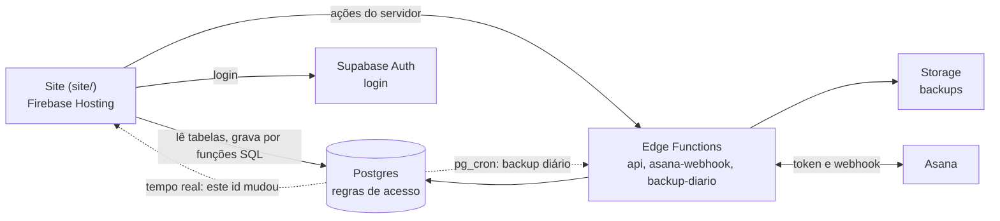

# Arquitetura

## As decisões principais

**O banco decide o acesso.** O navegador só organiza a tela. Tudo o que chega ao banco passa pela RLS ou por funções SQL que conferem o nível de quem chama. Veja [Segurança](seguranca.md).

**Os dados são documentos JSON.** As demandas e o meta ficam em colunas `jsonb` (`demandas.dados`, `sistema_meta.dados`), porque o app lê e grava a demanda inteira. Os comentários ficam dentro da demanda.

**A escrita passa só por funções SQL** (`demanda_salvar`, `meta_salvar`, `acessos_salvar`...). O usuário não tem permissão de gravar direto nas tabelas.

**O merge imita o do Firestore.** `jsonb_mesclar` soma mapas em profundidade, substitui listas e limpa o campo quando recebe um mapa vazio. O `||` do Postgres é raso e apagaria dados. Remoções vão à parte, como lista de caminhos.

**Só o servidor grava o vínculo com o Asana.** `demanda_salvar` ignora `asana`, `asanaTaskId`, `asanaTaskIds`, `asanaAnteriores` e `comentariosServidorAt`. Do `asanaAviso`, o app só marca o `cienteEm`.

**O tempo real só avisa.** O aviso diz qual id mudou, e o app relê a linha, porque acima de 1 MB o aviso chega sem os dados. Aviso perdido não volta, então tudo é relido ao reconectar e ao voltar para a aba depois de 60 segundos.

## Papéis

| Papel | O que pode |
|---|---|
| `admin` | Tudo, inclusive gerenciar usuários e baixar backups |
| `projetista` | Ler e gravar projetos, sem gerenciar usuários |
| `visibilidade` | Só ler |
| Papel fora dessa lista | Só ler |
| Desabilitado | Só ler |
| Removido ou fora da lista | Nada |

O administrador principal é fixo no banco e nunca perde o acesso, para o sistema não ficar sem quem corrija os papéis.

A regra existe em três lugares, que precisam mudar juntos: `acesso_nivel_de` (banco), `supabase/functions/_shared/acesso.mjs` (servidor) e `site/js/usuarios/user-roles.js` (tela). `tests/unit/acesso.test.mjs` compara os três em todas as combinações.

## Tabelas

| Tabela | Conteúdo | Quem lê |
|---|---|---|
| `demandas` | Um projeto por linha, em `dados` | Quem tem acesso |
| `sistema_meta` | Linha única: papéis, metas, filtros salvos e marcas de exclusão | Quem tem acesso |
| `sistema_backups` | Situação do último backup | Quem tem acesso |
| `acessos_historico` | Quem mudou o acesso de quem | Administradores |
| `asana_*` | Vínculos, envios, anexos e segredo dos webhooks | Só o servidor |

## O site

Os scripts não usam módulos: compartilham o escopo global, na ordem das tags `<script>` do `index.html`. Não há etapa de build, e o que está em `site/` é exatamente o que vai para a hospedagem.

A pasta `site/js/nuvem/` separa o acesso aos dados por responsabilidade:

| Arquivo | Responsabilidade |
|---|---|
| `supabase-config.js` | Endereço e chave pública do projeto |
| `supabase-auth.js` | Login, sessão e troca de senha |
| `supabase-persist.js` | Carregar, ouvir o tempo real e gravar |
| `consulta.js` | Cliente, limite de tempo e tradução de erros |
| `mesclagem.js` | Juntar servidor e cópia local (sem acessar nada de fora) |
| `copia-local.js` | Cópia no navegador e alterações feitas sem conexão |
| `acessos.js` | Lista de acessos: levar à tela e gravar |

Sem `supabase-config.js` preenchido, o site abre em modo local em `localhost` e mostra uma tela de manutenção no endereço publicado.

## As funções do servidor

| Função | Quem chama | Como se identifica |
|---|---|---|
| `api` | O app | Sessão do usuário. A identidade vem de `auth.users`, e cada ação confere o nível |
| `asana-webhook` | O Asana | Assinatura `X-Hook-Signature` sobre os bytes recebidos |
| `backup-diario` | `pg_cron`, às 03:10 de Brasília | Segredo próprio, no cabeçalho `x-backup-segredo` |

As ações da `api` ficam em `supabase/functions/_shared/api.mjs`, cada uma com o nível exigido e a mensagem de erro padrão.

## Limites

- **Edge Functions:** 2 s de CPU por pedido, 256 MB de memória e 150 s no plano Free (400 s nos pagos). Se a base crescer muito, `backup-diario` é a primeira a acusar.
- **Anexos:** 10 MB por arquivo. A documentação do Supabase não informa o tamanho máximo do corpo do pedido, então isso se confirma na virada.
- **Backups:** o plano Free limita cada arquivo a 50 MB. São mantidos os 30 mais recentes.
- **Plano:** no Free, o projeto é pausado por inatividade e não há backup automático do banco.
- **Sem conexão:** só a gravação de projeto fica guardada até reconectar. Diárias, acessos e exclusões mostram erro na hora.
- **Volume:** o app relê tudo ao abrir. Se a base passar de poucos MB, vale buscar só o que mudou, usando a coluna `alterado_em`, que já existe.
